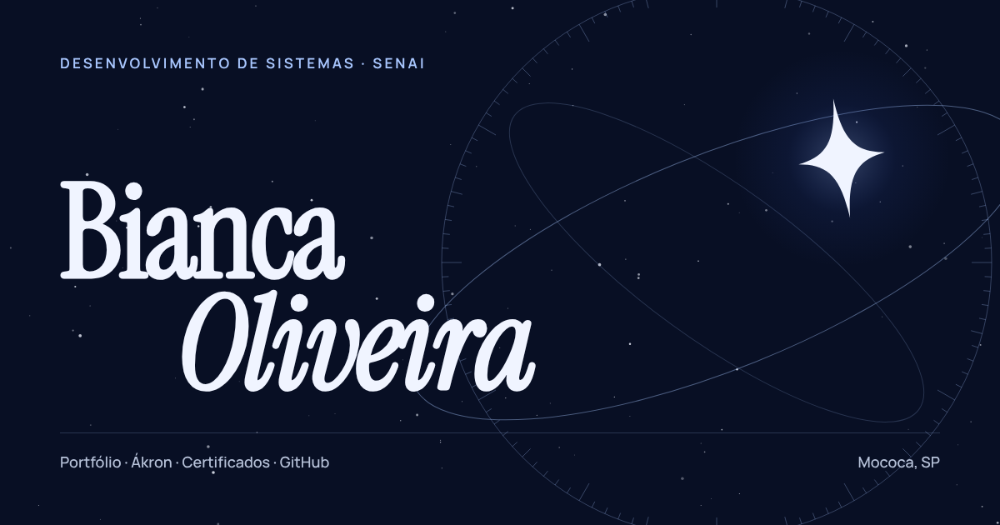

# Bianca Oliveira — Portfólio



Portfólio pessoal de **Bianca Moreira de Oliveira**, estudante de Desenvolvimento de Sistemas no SENAI (Mococa-SP).
Reúne o **Ákron** — TCC da equipe Athenas — como estudo de caso, as habilidades com a indicação de onde cada uma foi
usada, os certificados (com os dados pessoais removidos) e os projetos do GitHub.

- **Tecnologias:** React 19, TypeScript, Vite 8, CSS próprio, GSAP 3 (ScrollTrigger e SplitText), Lenis, Lucide e Simple Icons.
- **Sem back-end:** site estático, pronto para GitHub Pages, Vercel, Netlify ou qualquer hospedagem.
- **Lighthouse** (build de produção, medição local): desktop **100 · 100 · 100 · 100**; celular **95 · 100 · 100 · 100**
  (desempenho · acessibilidade · boas práticas · SEO).

## Sumário

1. [Rodar no computador](#rodar-no-computador)
2. [Estrutura do projeto](#estrutura-do-projeto)
3. [Editar o conteúdo](#editar-o-conteúdo)
4. [Adicionar ou atualizar certificados](#adicionar-ou-atualizar-certificados)
5. [Animações](#animações)
6. [Publicar](#publicar)
7. [Acessibilidade e qualidade](#acessibilidade-e-qualidade)
8. [Créditos e licenças](#créditos-e-licenças)

---

## Rodar no computador

**Requisitos:** [Node.js](https://nodejs.org) 20.19 ou mais novo (recomendado: 22 LTS) e npm.

```bash
npm install
npm run dev
```

Abra o endereço que aparecer no terminal (normalmente `http://localhost:5173`).

| Comando             | O que faz                                                                    |
| ------------------- | ---------------------------------------------------------------------------- |
| `npm run dev`       | servidor de desenvolvimento, com recarga automática                          |
| `npm run build`     | checa os tipos, gera o site em `dist/` e pré-renderiza o HTML da página       |
| `npm run preview`   | serve a pasta `dist/` para conferir o resultado do build                      |
| `npm run typecheck` | apenas a checagem do TypeScript                                              |

---

## Estrutura do projeto

```text
public/
  akron/              capturas reais do Ákron (WebP) e logo original (SVG)
  certificados/
    pdf/              PDFs públicos — versões TARJADAS
    img/              miniaturas e páginas dos certificados (WebP)
  fonts/              Instrument Serif e Manrope (licença OFL)
  img/                foto da Bianca (recortada, sem metadados)
  media/              vídeo de apresentação do Ákron
  og-image.png        imagem de pré-visualização para LinkedIn, WhatsApp etc.
scripts/
  prerender.mjs       coloca o HTML pré-renderizado em dist/index.html (roda no build)
  certificados/       scripts Python para tarjar PDFs e gerar as imagens
src/
  data/               TODO o conteúdo editável: textos, links, habilidades, projetos, certificados
  sections/           seções da página (akron/ contém o estudo de caso)
  components/         header, menu, constelação lateral, modais, mockups, estrela, ícones…
  animations/         GSAP, integração Lenis + ScrollTrigger e animações de entrada
  hooks/              seção ativa, efeito magnético, media queries
  styles/             CSS por área; cores, fontes e espaçamentos ficam em tokens.css
  utils/              caminhos de arquivos e formatação de datas
.github/workflows/    publicação automática no GitHub Pages
```

---

## Editar o conteúdo

Tudo o que aparece na página vem de `src/data/`. Para atualizar textos e links não é preciso mexer nos componentes.

| Quero mudar…                                                          | Arquivo                                                 |
| --------------------------------------------------------------------- | ------------------------------------------------------- |
| Nome, apresentação do topo, textos do “Sobre mim”, ficha, frase final | `src/data/profile.ts`                                   |
| E-mail, LinkedIn, GitHub                                              | `src/data/profile.ts` (`email` e `contacts`)            |
| Foto                                                                  | `src/data/profile.ts` (`photo`)                         |
| Habilidades                                                           | `src/data/skills.ts`                                    |
| Estudo de caso do Ákron                                               | `src/data/akron.ts`                                     |
| Outros projetos do GitHub                                             | `src/data/projects.ts`                                  |
| Certificados                                                          | `src/data/certificates.ts` + arquivos em `public/certificados/` |
| Itens do menu                                                         | `src/data/navigation.ts`                                |
| Cores, fontes e espaçamentos                                          | `src/styles/tokens.css`                                 |

**E-mail profissional.** Está vazio de propósito, porque não foi informado. Para exibir, preencha
`email: 'nome@dominio.com'` em `profile.ts`. Links com endereço vazio não aparecem no site.

**Foto.** A foto atual veio da página da equipe Athenas; foi recortada e teve os metadados removidos (o arquivo
original tinha a localização GPS de onde foi tirada). Para trocar, coloque a nova imagem em `public/img/` (WebP,
900 × 1125 e 560 × 700 px) e atualize `photo`. Para não usar foto, troque o objeto por `null`: no lugar entra uma
composição gráfica com a estrela.

**Habilidades.** A regra do portfólio é que cada item diga onde foi usado (repositório, TCC ou curso) — sem
porcentagens. Node.js e Python, citados no README do perfil, ficaram de fora por ainda não terem projeto público;
quando houver, basta adicionar. Os ícones disponíveis estão em `src/components/TechIcon.tsx` (Simple Icons para marcas,
Lucide para conceitos).

---

## Adicionar ou atualizar certificados

> ⚠️ **Os PDFs originais contêm RG, número da identidade/CPF, data de nascimento e códigos de autenticação.**
> Nunca envie os originais para o repositório. Publique apenas as versões geradas pelo script abaixo.

Requisitos: Python 3.10+ (no Windows, use `py` no lugar de `python`).

1. Crie a pasta `certificados-originais/` na raiz do projeto (ela já está no `.gitignore`) e coloque os PDFs lá.
2. Instale as dependências do script (só na primeira vez):
   ```bash
   python -m pip install -r scripts/certificados/requirements.txt
   ```
3. Gere as versões públicas:
   ```bash
   python scripts/certificados/tarjar_certificados.py certificados-originais public/certificados/pdf
   ```
   O script **remove o texto sensível do arquivo** (não é só uma tarja por cima), apaga QR codes e links, limpa os
   metadados e **interrompe tudo** se ainda encontrar algum dado pessoal no resultado. O nome de cada arquivo vem de
   `scripts/certificados/certificados.json`; arquivos novos recebem um nome gerado automaticamente.
4. Gere as imagens (miniatura, frente e verso):
   ```bash
   python scripts/certificados/gerar_imagens.py public/certificados/pdf public/certificados/img
   ```
5. Abra os PDFs gerados e confira com os próprios olhos.
6. Cadastre o certificado em `src/data/certificates.ts`. O `slug` é o nome do arquivo sem `.pdf`; `area` define o filtro.
   Total de horas e quantidade de certificados são calculados sozinhos.

**Sobre a verificação de autenticidade:** os códigos e QR codes foram omitidos porque identificam a aluna e levam ao
documento completo, com os dados pessoais. Se uma empresa pedir comprovação, o original pode ser enviado diretamente a ela.

---

## Animações

- **Lenis + GSAP no mesmo loop** (`src/animations/SmoothScroll.tsx`): o Lenis não tem `requestAnimationFrame` próprio;
  o ticker do GSAP chama `lenis.raf()` e cada rolagem atualiza o ScrollTrigger.
- **Animações declarativas:** marque um elemento com `data-reveal="lines" | "up" | "clip" | "draw"` ou
  `data-parallax="12"` e ele ganha a animação correspondente (`src/animations/useRevealAnimations.ts`).
- **Interações próprias do portfólio:** constelação lateral que se desenha conforme a leitura avança
  (`ConstellationNav`), carta celeste do topo, horizonte curvo entre seções, fluxo “do sensor à tela” fixado na tela
  (Ákron), abas do sistema web com transição por recorte, troca entre os temas claro e escuro nas capturas do app,
  botões magnéticos e prévia flutuante dos certificados.
- **Limpeza:** tudo é criado com `useGSAP`, que desfaz animações e ScrollTriggers quando o componente sai da tela.
- **Movimento reduzido:** com “reduzir movimento” ativado no sistema, o Lenis não é criado e nada é animado.
- **Desempenho:** o HTML é pré-renderizado no build; o JavaScript começa a carregar depois da primeira pintura; as
  animações abaixo da dobra são configuradas quando o navegador fica ocioso. Se a rede estiver lenta, o nome aparece
  sem esperar a animação de entrada.

---

## Publicar

### GitHub Pages (recomendado — já configurado)

1. Envie o projeto para o repositório (por exemplo `bywoliveira/portifolio`), na branch `main`.
2. No GitHub, abra **Settings → Pages → Build and deployment → Source** e escolha **GitHub Actions**.
3. A cada `push`, o workflow `.github/workflows/deploy.yml` gera e publica o site em
   `https://bywoliveira.github.io/portifolio/`.

Se o endereço final for outro, ajuste `VITE_SITE_URL` no arquivo `.env` (é usado nas pré-visualizações do LinkedIn e do
WhatsApp). O build funciona em qualquer subpasta, sem nenhuma outra configuração.

### Vercel

Importe o repositório. A Vercel detecta o Vite: build `npm run build`, saída `dist`. Depois, ajuste `VITE_SITE_URL`
para o domínio gerado.

### Netlify

Build command `npm run build`, publish directory `dist`.

### Qualquer hospedagem estática

Rode `npm run build` e envie o conteúdo da pasta `dist/`.

---

## Acessibilidade e qualidade

- HTML semântico, link “Pular para o conteúdo”, foco visível e navegação completa por teclado (abas com setas, modais
  com `Esc`, foco preso no modal e devolvido ao fechar).
- Textos alternativos em todas as imagens e contraste AA.
- Testado em 1440, 820 e 390 px de largura, sem rolagem horizontal.
- Mesmo sem JavaScript o conteúdo aparece, porque já vem pronto no HTML.

---

## Créditos e licenças

- Conteúdo, foto e certificados: Bianca Moreira de Oliveira.
- **Ákron:** projeto da equipe Athenas — Anna Hilda, Beatriz Gonçalves, Bianca Moreira, Carlos Eduardo e Marcelo Duzzi —,
  TCC do Técnico em Desenvolvimento de Sistemas, SENAI Mococa-SP, 2026. Capturas, logo e vídeo vêm dos repositórios
  [Nananilda/tcc](https://github.com/Nananilda/tcc) e [Nananilda/app_tcc](https://github.com/Nananilda/app_tcc).
- Fontes: Instrument Serif e Manrope — SIL Open Font License 1.1 (licenças em `public/fonts`).
- Ícones: [Lucide](https://lucide.dev) (ISC) e [Simple Icons](https://simpleicons.org) (CC0).
